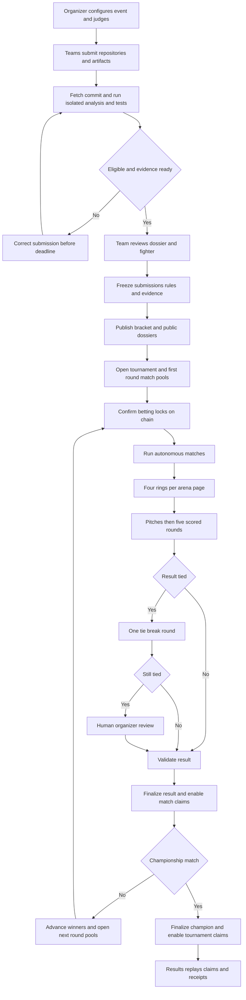

# AI Hackathon Battle Arena Product Requirements

**Version 1.4 · 6 November 2026 · Testnet release specification**

This product turns submitted hackathon projects into autonomous AI fighters. Each fighter pitches and defends a real project using a frozen GitHub repository, supporting artifacts, and automated test evidence. Three AI judges evaluate the projects through structured rounds. Spectators watch animated 1v1 battles and back match or tournament winners with testnet tokens.

The arena hosts its own competition. Its results are not official results of any external hackathon unless an organizer explicitly runs that event through this platform.

This PRD defines the user experience, functional requirements, scoring, agent behavior, testing, tournament lifecycle, settlement, failure handling, and release acceptance criteria. It is a product specification, not a statement that the system has already been implemented.

**Decision status:** requirements explicitly supplied by the product owner are identified below. Other numerical limits and operational rules are version 1 implementation defaults chosen to make the specification executable. They may be revised before an event opens for betting, but never silently changed during an active event.

# 1 Product objective and scope

## 1.1 Problem

Hackathon projects contain substantial work that spectators rarely inspect. Pitches compress that work into a few minutes, judging is often difficult to follow, and audiences have limited opportunities to participate. Existing project prediction platforms create spectator incentives, but the evaluation process itself can remain invisible.

The arena makes project evaluation a watchable event. Project agents explain their strengths, challenge competitors, respond to evidence, and receive public judge scorecards. Animated combat translates those evaluations into an understandable spectacle.

## 1.2 Product promise

Submit a project, review its AI representative, and let it compete autonomously. Watch why projects win, inspect the evidence, and back your predictions on testnet.

The product must deliver three connected outcomes:

- Builders receive visibility and an actionable evaluation of their project.

- Spectators can understand the competition without reading an entire repository.

- Organizers can run a tournament with clear rules, repeatable operations, and explicit settlement authority.

## 1.3 Confirmed owner decisions

- Battles are fully autonomous after submission; teams cannot intervene during a match.

- Project inputs include a GitHub repository and supporting photos, demos, PDFs, and text.

- Repository code is fetched and automated testing is included.

- The arena displays four fights per screen with navigation to additional screens.

- Individual fight view places the ring on the left and betting information on the right on desktop.

- Betting supports overall tournament outcomes and individual 1v1 outcomes.

- Betting is testnet only.

- Each settled pool allocates 70% to winning bettors, 20% to the winning project, and 10% to the platform.

- Engineering has 20% weight; product has the highest weight.

- An initial tie gets one tie-break round. A second tie requires a human organizer.

- NFC, OpenCV, hardware interactions, and live human pitching are outside scope.

## 1.4 Version 1 defaults

- Tournament capacities: 4, 8, or 16 projects; default 16.

- ETHGlobal-style prizes: every project competes for finalist standing, and may also enter up to three sponsor tracks (SUB-06). Each tournament covers one competition (finalists or one track), single elimination, three judges.

- Four fights per page does not mean four projects per tournament.

- Public GitHub repositories only.

- Text is the authoritative battle record; optional synthetic voice narrates the same text.

- Rubric: product 40%, engineering 20%, innovation 20%, feasibility 10%, defense 10%.

- One EVM-compatible testnet and one faucet-funded token per deployment; network selection is a deployment decision.

- Betting has no early withdrawal, cash-out, leverage, or stake-time multiplier.

- Claims are user-initiated; settlement creates claimable balances rather than sending funds to every bettor in a loop.

- Tests run before betting opens; fights use the resulting frozen evidence.

- Maximum eight simultaneously executing fights, supporting the first round of 16 teams.

- Human review target: 30 minutes; unresolved matches reach an event-resolution deadline 24 hours after their scheduled start.

## 1.5 Included and excluded

Release scope includes onboarding, organizer setup, submissions, GitHub ingestion, artifact processing, isolated testing, fighter creation, judge configuration, bracket generation, betting, live combat, human review, claims, refunds, and replay.

Excluded from version 1: mainnet or real-money use, private repositories, arbitrary language support, live code changes, agent-written repair patches, live betting after match generation begins, secondary trading, external hackathon result prediction, sponsor-funded prize payouts, audience-controlled scoring, custom user-supplied executable judge code, NFTs, and hardware integration.

No claim is made that passing automated tests certifies security or that AI scores establish objective project quality.

# 2 Roles and permissions

## 2.1 Visitor

Can browse public tournaments, project profiles, published evidence, live fights, completed scorecards, and replays without connecting a wallet. Cannot submit projects, place bets, or claim tokens.

## 2.2 Builder

Connects a wallet, verifies control of the submitted GitHub repository, submits artifacts, selects up to three tracks, previews the dossier, and previews the generated fighter. A designated team owner controls the submission and reward wallet before freeze.

Builders can correct factual inputs and request a rerun before the deadline. They cannot delete independently verified findings, alter judge instructions, modify frozen submissions, or intervene in battles.

A project may belong to several people, but version 1 pays one registered reward wallet. Internal team distribution is outside scope.

## 2.3 Spectator and bettor

Can watch without a wallet. A connected wallet can obtain faucet tokens, place permitted bets before cutoff, inspect its positions, claim rewards, and claim refunds.

Version 1 blocks registered team-owner and reward-wallet addresses from betting in their own tournament. It also blocks the event organizer and designated reviewer addresses. This is address-based enforcement, not proof that alternate-wallet participation is impossible.

## 2.4 Human organizer

Creates and configures the event, reviews eligibility, closes registration, publishes the bracket, monitors operations, and resolves second ties with a public rationale.

The organizer may pause execution for an operational failure or cancel an event under published conditions. They cannot change weights after freeze, reopen locked betting, reroll a valid result, or reverse a finalized result.

The organizer receives no automatic share of the 10% platform allocation unless the organizer is also the configured platform recipient.

## 2.5 Platform operator

Manages allowed runtimes, infrastructure, faucet integration, signing infrastructure, model access, and service incidents. Emergency controls can stop new bets or execution, but cannot redirect balances reserved for claims or refunds.

## 2.6 Service agents

Project advocates generate statements. Judges generate structured scorecards. Neither receives wallet signing keys or direct permission to move tokens. A separately authorized result service submits validated outcomes to the testnet contract.

This release uses an authorized result publisher and human reviewer. On-chain settlement makes the recorded outcome and distribution inspectable; it does not independently prove the correctness of off-chain judging.

# 3 End to end workflow



## 3.1 Organizer journey

Create event → publish sponsor track list and capacity → configure judges and rubric → publish registration → review submissions → confirm full bracket → freeze event → open pools → monitor live arena → resolve any human review → inspect settlement status → close event.

## 3.2 Builder journey

Connect wallet → verify repository control → create draft → select up to three tracks → add artifacts → run analysis → inspect test results and dossier → correct input if needed → preview fighter → submit → accept frozen version → watch autonomous matches → inspect evaluation → claim project allocation.

## 3.3 Spectator journey

Browse event → inspect projects and rules → watch without signing in or connect wallet → obtain testnet tokens → choose tournament or match pool → preview payout → confirm bet → follow arena → inspect verdict → claim payout or refund.

## 3.4 Lifecycle separation

Submission readiness, battle progress, result finalization, and token settlement are separate states. A completed animation is not evidence that a result is finalized. A finalized result is not evidence that every recipient has claimed.

# 4 Tournament setup and registration

**ORG-01 Event configuration.** Required fields are event title, description, sponsor track list, capacity, registration deadline, scheduled start, tournament betting cutoff, tournament resolution deadline, match betting duration, judge configuration, scoring policy, organizer wallet, reviewer wallet, token and network, platform recipient, and event-resolution policy.

**ORG-02 Configuration validation.** Enforce exactly three judges, scoring weights totaling 100%, supported bracket size, registration before betting, betting cutoff before execution, and a tournament resolution deadline at least (number of knockout rounds + 1) × 24 hours after scheduled start. That default is 5 days for 16 projects, 4 days for 8, and 3 days for 4. The organizer and reviewer may be the same person.

**ORG-03 Publish rules.** Before accepting any stake, expose the rubric, tie rule, payout formula, cancellation policy, human reviewer, network, and token. Record an immutable configuration version and hash.

**ORG-04 Capacity.** Admission is first-ready subject to organizer eligibility review. Waitlisted projects cannot receive bets. If the accepted count does not fill the selected bracket, the organizer may reduce capacity to a supported size or extend registration before freeze. Do not create version 1 byes or invented opponents. If fewer than four eligible projects remain, cancel before betting opens.

**ORG-05 Seeding.** Build the bracket once, after all dossiers are frozen (EVD-07) and before any pool opens. Round one pairs similar projects so each fight is a direct comparison; later rounds keep similar projects apart so they meet as late as possible.

- **Similarity.** Each pair of projects gets a fixed-point score: 60% cosine similarity of embeddings of the platform-generated dossier (intended user, problem, core journey, features, architecture), 20% overlap of selected tracks, and 20% overlap of technology detected from the frozen repository. Subtract the mean embedding before comparing. Team-written text and spectator signals are never inputs, so a team cannot choose its opponent through wording.

- **Round one.** Use the pairing with the highest total similarity across all fights, found exactly rather than greedily. Among equal totals, prefer the pairing whose least similar fight is most similar.

- **Later rounds.** Group round-one pairs so the least similar groups meet, at every level of the bracket. A category with several entrants is spread across both halves instead of eliminating itself early.

- **Exclusions.** Never pair in round one projects from the same team, a fork with its original, two forks of the same original (SUB-05), or any pair the organizer blocks with a published reason.

- **Audit.** Compute embeddings once after freeze and store the vectors. Persist and publish the seed, embedding model and version, similarity weights, algorithm version, a hash of all inputs, the bracket, and a hash of the result. Remaining ties follow an order derived from the seed. Anyone with the published inputs can recompute the same bracket. An organizer-generated seed is auditable after publication but is not claimed to be trustless randomness.

- **No rebuilding.** Reseeding, re-embedding, or changing weights is forbidden after betting opens. Show the similarity breakdown for each round-one fight on the tournament lobby and fight detail screens.

**ORG-06 Round scheduling.** Round one can run up to eight matches concurrently. Later rounds open only after every result in the preceding round is finalized. Default next-round betting window is five minutes.

**ORG-07 Withdrawal.** Before freeze, a team may withdraw. After freeze, there is no team-controlled withdrawal or code change. A serious eligibility issue goes to an organizer incident workflow; it cannot silently produce an arbitrary match winner.

**ORG-08 Event cancellation.** Cancellation stops unstarted matches and voids unresolved match pools and the unresolved tournament pool. Previously finalized match pools retain their results and claims. Cancellation does not claw back completed payouts.

# 5 Project submission and evidence

## 5.1 Submission fields

**SUB-01 Required inputs.** Version 1 keeps the form to seven fields: team name, project name, short pitch, what it does and how it's built, public GitHub URL, demo video link, and track selection (SUB-06). The connected wallet is the team-owner wallet and also the reward wallet. Submitting affirms the team owns the work and allows public display (SUB-03).

Teams do not supply build, test, or start commands. The platform detects the execution setup from the frozen repository during processing (TST-01). The default branch is used.

**SUB-01a Deferred inputs.** Not collected in version 1: team members, tech tags, self-declared limitations, built-at-event and start date, logo and cover image, branch or commit, monorepo path, deployed contract addresses, live demo URL, a separate reward wallet, per-track justifications, and uploaded artifacts (SUB-02).

**SUB-02 Supporting artifacts (deferred).** Accept JPG, PNG, WebP, PDF, UTF-8 text, MP4, and HTTPS demo links. Defaults: 20 MB per image/PDF/text upload, 200 MB per video, 500 MB total per project. Show limits before upload. Reject unsupported files and identify which item failed.

**SUB-03 Ownership.** Require proof of repository write/admin control through GitHub authorization or a one-time verification file committed to the repository. A public URL alone does not prove team ownership. The team must affirm that supplied artifacts may be used in the public arena.

**SUB-04 Autosave.** Preserve drafts and show last saved time. Wallet signatures authenticate submission ownership; reject replayed authentication challenges.

**SUB-05 Canonical identity.** Deduplicate repository, monorepo path, and project within an event. Forks require organizer review and disclosure of original work. Canonicalization must not conflate distinct monorepo applications.

**SUB-06 Track selection.** Follows the ETHGlobal prize model. Every accepted project automatically competes for **finalist** standing across the whole event. In addition, a team may select **up to three tracks** (sponsor/partner prize tracks) from the event's published track list. Zero tracks is allowed. Reject a fourth selection and any track not on the list. Track selections can change until freeze and are locked by it.

## 5.2 Repository snapshot

**EVD-01 Pin the commit.** Resolve the selected ref to an immutable commit SHA. Preserve the manifest, selected files, artifact hashes, dependency lockfiles, and analysis version. Live branch changes never alter frozen evidence.

**EVD-02 Fetch limits.** Default compressed download limit 250 MB and extracted limit 1 GB. Exclude build outputs, dependency directories, binaries not required for evaluation, and irrelevant generated assets from model context. Exclusions are recorded, not silently interpreted as missing work.

**EVD-03 Safe extraction.** Reject path traversal, symlink escapes, decompression bombs, unsupported submodule fetches, and links into private network addresses. Demo and artifact fetching must not access local files or internal services.

**EVD-04 Evidence records.** Each finding has an ID, claim, source type, commit/path/line reference or artifact timestamp/page, observation, status, and limitations.

Evidence statuses are: submitted claim, supported by code, observed in test, contradicted, or unverified. A finding may have multiple sources. “Unverified” is not synonymous with “false.”

**EVD-05 Dossier contents.** Summarize intended user, problem, core journey, features, architecture, innovation claims, dependencies, known limitations, test results, and unresolved questions. Separate README assertions from observed implementation.

**EVD-06 Corrections.** Builders can identify a factual error and supply a source. The system reanalyzes the affected claim and retains revision history. Builders cannot directly rewrite verified outcomes or the scoring policy.

**EVD-07 Freeze.** Freeze all accepted dossiers before any pool opens. Publish the same sanitized dossier and test summary to all spectators at the same time. Advocates and judges receive the same authoritative snapshot. Adversarial questions can be generated later, but underlying project evidence is fixed.

**EVD-08 Sensitive material.** Scan for credentials before public release. Do not expose discovered secrets in logs, transcripts, model prompts, or evidence previews. Flag the submission for remediation before freeze. Store only sanitized public evidence in replay records.

# 6 Automated testing

Automated testing is a release requirement, not a future placeholder. Version 1 deliberately supports a bounded set of project environments.

## 6.1 Supported execution profiles

**TST-01 Initial profiles.** Support Node.js/TypeScript projects with a lockfile and build/test commands detected by the platform from the repository (teams do not enter them; see SUB-01), and Solidity projects with Foundry or a supported Node-based test setup. Use pinned runtime images. Other stacks may be analyzed statically but are not eligible for this release's tournament until an execution profile is supported.

**TST-02 Execution stages.** Validate manifest → provision clean sandbox → install locked dependencies → build → execute repository tests → execute limited platform-authored checks → collect artifacts → destroy sandbox.

A Node web app may also receive a startup and basic browser smoke check when the platform detects a supported local start command. This checks launchability and a limited journey, not universal product correctness.

**TST-03 Test provenance.** Label repository-provided tests separately from platform-generated tests. Record test source, exact command, environment image, commit, exit status, timestamps, resource usage, and sanitized logs.

**TST-04 Generated checks.** Platform-generated checks must cite a declared requirement or code contract and operate under a published budget. A failed generated check is a candidate finding until the test's assumptions and setup are validated. Incorrect tests cannot count as project failures.

## 6.2 Isolation and budgets

**TST-05 Isolation.** Run untrusted code in disposable sandbox infrastructure isolated from the application, database, signer, cloud credentials, and host filesystem. Sandbox escape testing is a release gate.

**TST-06 Network policy.** Dependency installation may access allowlisted package registries through a controlled proxy. Test execution has outbound access disabled by default. Supported chain interactions use disposable local chains; no production wallets or private RPC credentials are supplied.

**TST-07 Resource defaults.** Per run: 2 virtual CPUs, 4 GB memory, 10 GB temporary disk, and 10 minutes total execution time. Repository test logs are capped at 10 MB. Limits apply equally to both projects and are disclosed before submission.

**TST-08 Repeatability.** Retry one infrastructure failure in a fresh sandbox. Do not repeatedly rerun until a favorable result appears. If two comparable runs disagree, record the test as flaky/inconclusive and preserve both outcomes.

## 6.3 Outcome classification

- **Passed:** the stated check completed and its assertions passed.

- **Failed:** a valid check ran and produced a reproducible assertion or application error.

- **Blocked:** required configuration or an undeclared external dependency prevented execution.

- **Infrastructure error:** the runner or service failed independently of the submitted project.

- **Timed out:** the declared execution budget expired.

- **Unsupported:** the environment is outside the release's supported profiles.

- **Not provided:** no relevant repository test exists.

- **Inconclusive:** evidence does not support a reliable pass/fail finding.

**TST-09 Scoring interpretation.** Judges must not equate test counts with quality, absence of tests with a proven exploit, or infrastructure errors with product failure. Engineering scores consider reproducibility and meaningful coverage; product scores consider what the available evidence actually demonstrates.

**TST-10 Frozen reports.** Complete test execution before pools open. Do not run new private tests mid-match or change the evidence after betting locks. Live “prove it” moments reveal frozen evidence and logs in version 1.

**TST-11 Readiness.** An unexplained runner failure prevents evidence freeze until resolved. A reproducible project build failure may remain eligible with a prominent disclosed limitation if the organizer applies the same eligibility policy to all entrants. Unsupported profiles are rejected before betting.

# 7 Fighter and judge agents

## 7.1 Project fighters

**AGT-01 Persona generation.** Create a fighter name, visual archetype, optional voice, speaking style, opening pitch, and project advocacy brief from the approved dossier.

**AGT-02 Customization (deferred).** Version 1 takes no fighter customization input from teams. The platform generates the fighter's name, avatar (from licensed presets), voice, and tone from the approved dossier; teams can preview it but not edit it. Factual errors are fixed through EVD-06 corrections. Personality never changes scoring weights, evidence access, or tool permissions.

**AGT-03 Grounded advocacy.** An advocate can explain strengths, challenge evidence, acknowledge limitations, and distinguish implemented features from future plans. It cannot invent adoption, benchmarks, deployments, tests, partnerships, or code references.

**AGT-04 Equal resources.** Both advocates use the same model configuration, context budget, response length, number of retrieval calls, and time budget. Input order alternates across rounds. Persona tone does not grant additional resources.

**AGT-05 Allowed tools.** Read-only retrieval of the frozen dossiers and evidence. No arbitrary web browsing, code edits, shell access, additional repository fetching, or access to other agents' private reasoning.

**AGT-06 Output contract.** Every event includes match, round, actor, event type, display text, referenced evidence IDs, and a structured claim type. The service validates references and length before publishing.

## 7.2 Judges

**JDG-01 Three viewpoints.** Default judge personas are a product/user advocate, an engineering reviewer, and an innovation/feasibility reviewer. All three score every criterion under the same rubric; persona specialization affects questioning, not hidden weight changes.

**JDG-02 Custom judge settings.** Organizer settings include public name, avatar, supported voice, tone, and additional track-specific guidance. Guidance is bounded by platform instructions, the fixed rubric, and equal-treatment rules. Voice affects narration only.

**JDG-03 Independence.** Judges produce scorecards independently and cannot see one another's scores until all three are committed for that round. Distinct personas do not imply statistically independent models; do not market them as such.

**JDG-04 Rationale.** Each score includes a concise justification, evidence IDs where applicable, and uncertainty. Subjective product judgments must identify their reasoning rather than pretend to be test results.

**JDG-05 Validity.** Scores must fall within allowed bounds and use valid criterion IDs. Missing, malformed, or unsupported outputs trigger one repair attempt. Continued failure pauses the match; the system never invents a judge score.

**JDG-06 Incentive separation.** Judges and advocates cannot see pool sizes, odds, stake amounts, spectator popularity, or platform revenue. Those signals cannot influence evaluation.

**JDG-07 Prompt isolation.** Repository comments, README files, PDFs, transcripts, and opponent messages are untrusted content. Instructions embedded in them never override agent roles or scoring policy.

**JDG-08 Versioning.** Freeze model identifier, prompt version, retrieval configuration, and rubric for the event. Store generated outputs for replay. Replay uses stored events; it does not rerun the models or claim deterministic regeneration.

# 8 Battle format and combat

## 8.1 Match sequence

**BAT-01 Preconditions.** A match cannot execute until both projects are eligible, snapshots and judge settings are frozen, the round is scheduled, and the corresponding betting lock has reached the configured chain confirmation threshold. For round one, the tournament pool must also be locked.

**BAT-02 Intro.** Introduce fighters, project descriptions, judge panel, and rubric. Show the frozen commit and evidence status in the details panel.

**BAT-03 Opening pitches.** Both advocates receive one opening pitch, capped at 60 words each. First speaker alternates by bracket slot parity.

**BAT-04 Five scored rounds.** Run product, engineering, innovation, feasibility, and defense rounds in that order. Each round produces one sealed score per judge per fighter. The defense round reviews how accurately both agents handled the preceding exchanges.

**BAT-05 Round structure.** One judge asks a common criterion-specific question; both agents answer. Each advocate then gets one evidence-backed challenge against the other and one response to the opponent's challenge. In the defense round, the common question and challenges focus on unresolved claims and tradeoffs from earlier rounds.

Defaults: 50 words per answer, 40 per challenge, 50 per rebuttal. Questions are at most 30 words. The per-turn generation timeout is 30 seconds, with one identical-budget retry on a service error.

**BAT-06 Closing statements.** Before the defense round is scored, allow one 40-word closing statement per advocate. Closing statements cannot introduce new artifacts or revise sealed earlier-round scores.

**BAT-07 Rulings.** Classify each challenge as upheld, partially upheld, rejected, or inconclusive. A majority of three judge classifications determines the label. If no label has a majority, display “mixed ruling.” Scores are still computed under the fixed rubric.

## 8.2 Damage and health

**BAT-08 One source of truth.** Scoring determines combat. Random animations, cosmetic rarity, avatar size, voice style, spectator votes, and stake volume never change damage or the result.

Both fighters begin at 100 health. Each sealed criterion consumes a damage budget proportional to its weight. Health is stored as integer thousandths and is always calculated from sealed judge scores, using the same rounding rule as the final score (section 9.2):

```text
points_kept = 30000 − sum across the 3 judges and all sealed criteria of
              (weight_percent × (100 − criterion_score))

score_so_far_in_hundredths = floor((2 × points_kept + 3) / 6)
health_in_thousandths = 20000 + 8 × score_so_far_in_hundredths

round_damage = previous health_in_thousandths − new health_in_thousandths
```

Before any round is sealed, points_kept is 30000 and health is 100.000. After all five criteria, points_kept equals weighted_total, so:

```text
final_health = 20 + 0.8 × final_score
```

This single calculation is the only source of health. Equal final scores therefore always give exactly equal final health, and a higher final score always gives higher final health. Health measures judged performance, not literal security or reliability.

**BAT-09 Attack animation.** Show an attack preparation while the challenge is presented, a response animation during rebuttal, and the ruling afterward. Apply authoritative health changes only when the round score is sealed. If several criticisms contributed, show a round damage breakdown; do not fabricate a precise causal attribution the judges did not supply.

Rejected attacks show a block. Inconclusive attacks show a neutral exchange. Round score loss unrelated to a specific attack is shown as a judge penalty with its explanation.

**BAT-10 No premature knockout.** The health floor is 20 because every entrant must receive every scheduled opportunity. The win animation follows the recorded result, in this order: higher final score, then higher tie-break score, then organizer decision. Without a tie, the winner is also the higher-health fighter. After a tie, health stays equal, so the screen must show the tie-break score or organizer decision as the reason for the win. No win animation plays while human review is pending. The product must not suggest that reaching zero health caused a result.

**BAT-11 Numerical consistency.** Compute score and health in fixed-point arithmetic from the same stored scorecard. Display two decimal places, rounding half up from stored thousandths. If health rounding visually obscures a very small difference, show the deciding score explicitly.

## 8.3 Example

A project's final score is 82.00. Its health is 85.60. An opponent scoring 78.00 finishes at 82.40 health. The first project wins. There is no separate combat winner who can disagree with the scorecard.

An upheld engineering critique can cause a visible hit, but engineering has only 20% total weight. It cannot erase a stronger product result by receiving an arbitrary critical-hit multiplier.

## 8.4 Playback

**BAT-12 Event ordering.** Every event has a monotonically increasing sequence number and server timestamp. Clients animate the authoritative stream in order and deduplicate repeats.

**BAT-13 Reconnect.** Reconnecting clients retrieve a state snapshot and missing events. They do not start a new battle or duplicate damage.

**BAT-14 Duration.** Target a typical match of 10–14 minutes, excluding tie-break rounds, human review, and service incidents. The word caps allow at most about 1,750 words per match, or roughly 12 minutes of speech at 150 words per minute. This is a performance target, not a reason to skip turns. Streaming text may appear before optional speech completes; narration may be skipped without changing the authoritative timeline.

# 9 Scoring and ties

## 9.1 Rubric

**Product usefulness and user journey — 40%.** Problem clarity, identifiable users, usefulness, coherence of the core journey, accessibility/usability evidence, and whether the demonstrated experience meets the claimed need. Polished visuals alone do not establish product value.

**Engineering and implementation — 20%.** Completeness, reproducibility, sound architecture, meaningful testing, dependency choices, and handling of important failure cases. Tests provide evidence rather than an automatic score.

**Innovation and differentiation — 20%.** Distinct approach, meaningful improvement over obvious alternatives, and track relevance. Novelty claims require a stated basis and must not be inferred solely from branding.

**Feasibility and business model — 10%.** Practical delivery, operating assumptions, costs, adoption path, and appropriate sustainability or monetization. Open-source/public-good projects may explain sustainability without inventing revenue.

**Evidence-backed defense — 10%.** Accuracy, direct answers, justified rebuttals, acknowledgment of uncertainty, and consistency with the frozen submission. Charisma or aggression is not a substitute for correctness.

Extra “brownie points” must be expressed as a published subcriterion inside an existing weight. There is no uncapped bonus pool.

## 9.2 Calculation

Each judge supplies integer criterion scores from 0 through 100. For each project:

```text
weighted_total =
    sum across the 3 judges and 5 criteria of (weight_percent × criterion_score)

final_score_in_hundredths = floor((2 × weighted_total + 3) / 6)
display_score = final_score_in_hundredths / 100
```

This is the equally weighted mean of three judges' weighted scores, rounded once to 0.01 out of 100 using half-up rounding. Compare the same rounded integer that users see. A tie means equality of these final integers; there is no undisclosed epsilon or hidden precision tie-break.

Round scores are sealed after valid outputs from all judges. Later speech cannot retroactively revise them. If validation detects a calculation or schema defect before finalization, correct the processing error through an audited recovery, not by asking for a more favorable judgment.

## 9.3 First tie

**TIE-01 Single tie-break round.** If the initial final scores are equal, run one extra common question about product usefulness and the strongest unresolved tradeoff, selected from the frozen evidence. Each agent gets one 150-word answer and one 100-word rebuttal.

Judges score the tie-break independently: product reasoning 60% and evidence/defense accuracy 40%. Aggregate across three judges with the same fixed-point and rounding rule. Only this tie-break score decides between otherwise tied entrants.

**TIE-02 Display.** Preserve the original tied score and health. Show a separate tie-break meter and score; do not rewrite the main five-round scorecards.

## 9.4 Second tie and organizer review

**TIE-03 Human review.** If tie-break scores are also equal, transition to HUMAN_REVIEW_REQUIRED. Do not run further AI tie-breaks or choose randomly.

**TIE-04 Review package.** Show the organizer both dossiers, tests, original and tie-break transcripts, individual scorecards, references, and an explicit decision form. The reviewing interface hides betting exposure and projected platform revenue.

**TIE-05 Decision.** The organizer selects one project and writes a reason referencing the published criteria and evidence. Record identity, timestamp, and rationale publicly. Original AI scores remain unchanged; mark the winner “Organizer decision after two ties.”

**TIE-06 Freeze dependent actions.** Keep the match pool locked, with no claims; do not open the next round until all current-round winners are known. Other matches already running may finish normally.

**TIE-07 Deadline.** At 30 minutes, mark review overdue and alert the organizer in-app. At the fixed 24-hour resolution deadline, an unresolved match is voided, remaining event rounds are canceled, and unresolved pools are refundable. No arbitrary project advances. Previously finalized match pools remain settled.

The deadline transition must be callable by a keeper or any authorized public settlement caller after the published timestamp; it must not depend on an absent organizer.

**TIE-08 Absolute pool deadlines.** Every pool stores a fixed resolution deadline on chain when it is created. A match pool uses its scheduled start plus 24 hours. The tournament pool uses the published tournament resolution deadline, so it is protected even when no later match has been scheduled. If a pool is unresolved at its deadline, anyone may void it and its stakes become refundable. The contract rejects any result submitted at or after the deadline. Pausing does not extend a deadline. A void tournament pool also cancels any remaining competition; previously finalized match pools remain settled.

# 10 Betting pools and payouts

## 10.1 Pool types

**BET-01 Tournament pool.** One pool per tournament; selections are all accepted projects. It opens after dossiers and bracket are frozen and closes before any first-round battle generation begins.

**BET-02 Match pool.** One pool per match; exactly two selections. Later-round pools open only after the participants are finalized. The tournament pool never reopens between rounds.

**BET-03 Separation.** A tournament bet does not also create a match bet. Separate identifiers, positions, balances, deadlines, winners, and receipts must be visible.

## 10.2 Entry and lock

**BET-04 Testnet identification.** Every funding and betting surface names the test network and token and says that tokens have no promised cash redemption.

**BET-05 Position creation.** Connect wallet → verify network → obtain faucet tokens if needed → choose selection → enter amount → preview → approve token allowance if required → submit bet → show pending → confirm on chain.

**BET-06 Validity.** Reject zero stakes, unsupported tokens, insufficient balances, unauthorized participant wallets, duplicate transaction processing, and bets received at or after cutoff. Use chain time and contract state for enforcement; a UI countdown is advisory.

**BET-07 Limits.** Default minimum 1 test token, maximum 1,000 per wallet per pool. Multiple bets accumulate into positions and the cap applies across all selections. Backing both sides is permitted but creates separate positions and is not represented as guaranteed profit.

**BET-08 No withdrawals.** Positions cannot be reduced, transferred, cashed out, or withdrawn. Only settled claims or void-pool refunds release funds.

**BET-09 Lock integrity.** The result service must see a confirmed lock before generating match-specific agent outputs. If lock confirmation is delayed, delay the match. A late transaction that misses cutoff is rejected even if the user initiated it earlier.

## 10.3 Payout formula

Let P be the pool's settled accepted stake total in integer token base units, W the total stake on the winner, and s a bettor's winning stake.

```text
bettor_bucket = floor(P × 70 / 100)
project_bucket = floor(P × 20 / 100)
platform_bucket = P − bettor_bucket − project_bucket

bettor_claim = floor(bettor_bucket × s / W)
```

The platform bucket absorbs only the base-unit remainder from the percentage split. Individual bettor floor-division dust remains reserved until all winning positions are claimed; then a permissionless sweep may transfer only the residual dust to the platform. Unclaimed user entitlements never become sweepable solely because time elapsed.

The bettor claim is the total amount received, including any returned principal. There is no separate principal refund in a settled pool.

**BET-10 Example.** With 1,000 tokens total, 400 on the winner, and a user's 100-token winning stake: bettors share 700; the user claims 175; the winning project receives 200; the platform receives 100. That user's net gain is 75.

**BET-11 Correct selection can still lose value.** If 900 of the same 1,000 tokens backed the winner, a 100-token position claims approximately 77.78 before integer rounding. Show this possibility in the preview. Picking the winner does not guarantee a payout larger than the stake.

**BET-12 Estimated returns.** Display current-pool estimates including the allocation split. Never label pool-implied ratios as objective AI win probabilities. Estimates change until cutoff.

## 10.4 Special pool outcomes

- Empty pool: finalize with no transfers; the match still runs.

- One-sided pool: if all accepted stakes at lock back one selection, void the pool at lock and refund every accepted stake, whichever project later wins. Project and platform get zero from that pool, and the match still runs. The bet preview must explain this possibility.

- No stake on the eventual winner: void the pool and refund every accepted stake; project and platform get zero from that pool. Because of the one-sided rule, this can only happen in a tournament pool.

- Canceled or void match: refund full accepted stakes with no platform or project allocation.

- Human review: no payout or refund merely because review is pending.

- Network/service outage: preserve balances and state; do not infer a match winner from an outage.

**BET-13 Claims.** Bettor, project, and platform allocations are separate claim types. Claims are idempotent, protected against reentrancy and duplicate consumption, and cannot exceed pool reserves. Failed transfers must not consume claim entitlement.

**BET-14 Frozen recipients.** Project reward wallet and platform recipient are fixed before pool opening. A later account compromise cannot authorize silent redirection of accrued rewards.

**BET-15 Completion.** Match settlement enables match claims. Championship finalization also settles the separate tournament pool. A champion can receive allocations from several match pools and the tournament pool because they contain different stakes.

# 11 State machines and operational recovery

## 11.1 Project state

DRAFT → INGESTING → ANALYZING → TESTING → REVIEW_READY → SUBMITTED → ACCEPTED → FROZEN.

NEEDS_CHANGES can return to ingestion before the deadline. REJECTED and WITHDRAWN are terminal for that submitted version. Every rerun creates a new version; frozen versions cannot be overwritten.

## 11.2 Tournament state

DRAFT → REGISTRATION_OPEN → PREPARING → FROZEN → BETTING_OPEN → RUNNING → COMPLETED.

PAUSED is an operational state preserving the prior stage and deadlines. CANCELED stops remaining competition and triggers unresolved-pool refunds. COMPLETED requires a finalized champion, not all claims having been withdrawn.

## 11.3 Match state

SCHEDULED → BETTING_OPEN → LOCK_PENDING → LOCKED → RUNNING → VALIDATING → FINALIZED.

A tie routes RUNNING → TIEBREAK_RUNNING → VALIDATING or HUMAN_REVIEW_REQUIRED. Human review produces VALIDATING after a signed decision. A recovery may enter PAUSED; an unrecoverable match enters VOID.

## 11.4 Pool state

CREATED → OPEN → LOCKED → RESOLVED.

A locked pool moves to VOID instead of RESOLVED when it is one-sided at lock, when its match or event is canceled or voided, when no stake backs the winner, or when its resolution deadline passes. RESOLVED exposes claims. VOID exposes refunds. Both are terminal outcome states. “Claimed” belongs to individual entitlements, not to the whole pool. Settlement must be exactly-once even if a job, webhook, or transaction confirmation is delivered repeatedly.

## 11.5 Recovery rules

**REC-01 Retry boundaries.** Retry transport or schema failures once with recorded attempt IDs. Preserve completed valid turns. Never regenerate a valid completed match to obtain a different result.

**REC-02 Incomplete turn.** A failed advocate call does not cause damage or a default loss. If retry fails, pause; resume from the last committed event when service returns.

**REC-03 Missing judge.** Require all three valid scores. Do not average only the judges that happened to respond.

**REC-04 Service restart.** Recover state from persisted events and checkpoints. Clients, queues, and animation timelines are not the source of truth.

**REC-05 Chain delays.** Distinguish proposed, submitted, confirmed, and failed transactions. Do not display claimable balances before settlement confirmation.

**REC-06 Reorganizations.** Reconcile removed or replaced chain events using transaction/block identity and the selected network's confirmation policy. Avoid off-chain advancement until result finalization meets that policy.

**REC-07 Irrecoverable failure.** One void competitive match prevents completion of its knockout branch. Version 1 cancels the remaining tournament rather than inventing a winner. Refund all unresolved pools; preserve previously finalized matches.

**REC-08 Audit trail.** Record every pause, retry, correction, review, cancellation, finalization, and refund authorization with actor, timestamp, reason, and before/after state.

**REC-09 Finality.** After result finalization, score disagreements cannot reverse that result. Corrections may be appended publicly but do not mutate paid outcomes. A future dispute protocol is outside this release.

# 12 Screens and interaction requirements

## 12.1 Explore

**UI-01** Show upcoming, live, completed, and canceled tournaments with track, participant count, start time, and status. Default to live events, then upcoming. Provide clear actions to watch, inspect, or submit. Empty states explain the next action; never fabricate active events.

## 12.2 Tournament lobby

**UI-02** Show event description, countdowns, accepted fighters, bracket, judges, rubric, rules, testnet details, and tournament betting panel. Distinguish tournament-wide betting from individual matches. Show project readiness before freeze and public dossiers after freeze.

The bracket links to each match and indicates scheduled, live, human review, finalized, or void status. A paused match is never rendered as a lost match.

## 12.3 Submission wizard

**UI-03** Steps are project details, track selection, GitHub ownership and commit, artifacts, analysis and testing, fighter preview, and confirmation. There are no execution-setup or fighter-customization steps.

Preserve form input across recoverable failures. Show per-stage progress rather than an indefinite spinner. Provide actionable errors, relevant sanitized logs, and a correction action before freeze. Submission confirmation includes the exact commit and reward wallet.

## 12.4 Project profile

**UI-04** Show project pitch, fighter, team attribution, selected tracks, source link, pinned commit, artifacts, verified/unverified claims, test summary, match history, and published scores. Evidence cards link to the exact snapshot rather than a mutable branch.

Do not display speculative strengths as confirmed facts. Do not display private agent reasoning or raw secrets.

## 12.5 Arena overview

**UI-05** Render four fight slots per page in a desktop 2×2 layout, preserving the aerial wrestling-ring aesthetic. Page controls show the number of pages and active page. With eight matches, show two pages; with fewer than four remaining matches, show only the actual matches.

Each ring shows fighters, project names, health, round, status, and an “Open fight” action. Pagination changes the viewer's subscription and view, not the match execution state.

**UI-06** Support filters for round and status plus “my bets.” Preserve the selected event, round, page, and filter in navigation state. Expose important review or result notices from off-screen rings without forcing navigation.

**UI-07** Mobile uses a stacked layout for the same four matches per page. Do not shrink unreadable text to preserve four simultaneous rings on a phone. Only the focused fight plays audio.

## 12.6 Fight detail

**UI-08** Desktop places ring and fighters on the left, betting on the right, and dialogue/evidence below. Mobile stacks these sections with tabs or anchored navigation.

The header shows event, round, participants, match state, pool cutoff, and live/replay status. Before lock, allow betting. After lock, replace inputs with positions, pool totals, and the relevant settlement state.

**UI-09** Include current speech, round indicator, health, recent rulings, full transcript, judge scores, evidence drawer, mute, captions, reduced motion, and replay controls. Show original and tie-break scores separately.

**UI-10** During human review, retain the full fight and show “Awaiting organizer decision.” Explain that advancement and settlement are paused. After review, show the organizer's public rationale beside the unchanged AI scorecards.

## 12.7 Wallet and portfolio

**UI-11** Show network, token balance, faucet action, bet history, pending transactions, settled positions, claimable winnings, project rewards, and refunds. Group by pool type and event.

A rejected wallet signature returns the user to an editable form. Wrong-network, insufficient-gas, insufficient-token, expired-cutoff, reverted-transaction, and pending-confirmation states must have distinct messages.

## 12.8 Organizer console

**UI-12** Include setup, eligibility queue, evidence readiness, bracket preview, execution health, review queue, result publication status, and cancellation controls.

Human review requires deliberate winner selection and a written rationale. Show consequences before canceling an event: unresolved pools refund, future matches stop, finalized matches remain unchanged. Preserve an audit record.

## 12.9 Results and replay

**UI-13** Show champion, complete bracket, per-project evaluation, evidence, final allocation totals, claims status, and replay links. Replays reconstruct the stored event stream and indicate any organizer-decided outcome.

## 12.10 Accessibility and communication

**UI-14** All critical information must be available in text. Use keyboard-accessible controls, visible focus, captions, screen-reader labels, contrast suitable for the chosen accessibility target, and reduced-motion alternatives. Health and status cannot rely on color alone.

**UI-15** Render times in the viewer's timezone while storing UTC; show the event timezone where schedules could be ambiguous. Confirmed on-chain state takes precedence over local clocks.

**UI-16** Notifications are in-app in version 1. Events include submission ready, correction required, betting cutoff, match start, second tie, organizer decision, result finalized, claim available, and refund available. Deduplicate notices and link to the relevant screen.

# 13 Data and service boundaries

This section defines required responsibilities and records without prescribing a frontend library, database vendor, or model provider.

## 13.1 Core records

- **User and wallet:** public identity, wallet addresses, authentication challenges, and role assignments.

- **Tournament:** organizer, reviewer, track, capacity, schedule, rules version, rubric, judge configuration, token/network, and lifecycle.

- **Project:** team ownership, reward wallet, canonical repository identity, selected tracks (up to three), accepted submission version, and fighter profile.

- **Submission snapshot:** commit SHA, artifact hashes, file manifest, runtime profile, freeze timestamp, and evidence version.

- **Evidence item:** claim, provenance, source reference, status, observation, and limitations.

- **Test run:** environment, command, test origin, resource limits, outcomes, sanitized logs, and timestamps.

- **Judge configuration:** persona, voice, model/prompt versions, criteria, and validated settings.

- **Match:** bracket position, participants, schedule, state, turn budgets, event cursor, scorecards, and decision source.

- **Battle event:** ordered sequence, actor, round, type, text, evidence references, score/health changes, and timestamp.

- **Human review:** assigned organizer, tie records, deadline, decision, rationale, and signature.

- **Pool:** scope, selections, contract/network/token, cutoff, accepted totals, state, and result.

- **Position and entitlement:** wallet, selection, stake total, confirmed transactions, claim/refund amounts, and consumption status.

- **Audit event:** actor, action, object, prior/new state, reason, and correlation identifiers.

## 13.2 Logical services

- Web application renders screens and wallet actions.

- Application service authenticates users and enforces roles.

- Submission service fetches repositories and processes artifacts.

- Testing service executes isolated workloads.

- Evidence service stores snapshots and serves bounded retrieval.

- Tournament orchestrator schedules rounds and advances the bracket.

- Agent service generates advocates, questions, rulings, and scorecards.

- Event service persists and streams battle events.

- Settlement service validates finalized outcomes and publishes authorized transactions.

- Chain indexer reconciles bets, locks, outcomes, claims, and refunds.

- Monitoring service tracks reliability and resource use.

## 13.3 On-chain and off-chain responsibilities

On-chain: pool identity and configuration hash, token custody, selection IDs, stakes, cutoffs, resolution deadlines, lock state, result authority, winner or void state, allocations, claims, refunds, and relevant result/evidence commitments.

Off-chain: repository contents, artifacts, test logs, agent prompts, transcripts, rendered animation, and full scorecards. Store content hashes or equivalent commitments with the result so tampering can be detected, while maintaining accessible off-chain copies.

The result publisher sends a structured, authenticated result. The contract does not parse agent prose or accept a winner directly from an LLM.

## 13.4 Consistency rules

**DAT-01** Every write that could be retried has an idempotency key or unique event identity.

**DAT-02** Bracket advancement, result publication, and settlement jobs use the same finalized result record.

**DAT-03** Pool balances derive from confirmed chain activity, not optimistic UI totals.

**DAT-04** Use integer token units and fixed-point scores. Floating-point calculations cannot determine payouts or winners.

**DAT-05** Retain sanitized evidence, scorecards, and transcripts for at least 90 days after the event. Retain claim entitlement and chain references for as long as unclaimed funds exist. Remove execution sandboxes immediately after log/artifact collection.

# 14 Security and integrity requirements

**SEC-01 Authentication.** Wallet sign-in uses expiring, domain-bound, single-use challenges. GitHub ownership verification is separate from wallet authentication.

**SEC-02 Access control.** Check ownership and role server-side for submissions, freeze operations, reviews, and cancellation. UI visibility alone is not authorization.

**SEC-03 Signing separation.** Agent and test workers cannot access settlement keys. Use a limited-purpose signing service with event-scoped permissions and audited requests.

**SEC-04 Evidence integrity.** Validate source references, pin commits, hash artifacts, and preserve revisions. Public evidence and agent evidence must correspond to the same frozen snapshot.

**SEC-05 Prompt injection.** Test malicious READMEs, source comments, PDFs, and opponent messages that attempt to change scores, leak secrets, or invoke tools. They remain data.

**SEC-06 Sandbox containment.** Enforce filesystem, process, network, time, memory, and output limits. No privileged host mounts or container daemon access.

**SEC-07 Financial invariants.** Accepted stake equals allocated or refundable reserves plus documented rounding remainder. No claim can be consumed twice. No administrative operation can withdraw user-reserved funds.

**SEC-08 Outcome leakage.** Do not generate match-specific pitches, attacks, scorecards, or private predictions before betting locks. Pre-betting analysis is limited to public dossiers and frozen test evidence.

**SEC-09 Fairness.** Enforce equal advocate budgets, identical evidence availability, fixed judges, and the same scoring rules. Restrict opponent evidence to the canonical dossier, not speculative private research.

**SEC-10 Abuse controls.** Apply submission size limits, per-wallet/action rate limits, malicious-content screening, and output moderation. Criticism targets project claims and implementation, not personal traits or harassment.

**SEC-11 Emergency behavior.** Pausing blocks new risk-taking operations while preserving completed claims where technically safe. Emergency controls must not become a route for changing valid winners.

**SEC-12 No inflated assurances.** The interface must not claim trustless judging, guaranteed profit, comprehensive security auditing, or verified novelty.

# 15 Performance reliability and observability

The following are proposed release targets to verify against the supported workload, not measured current performance.

## 15.1 Workload targets

- One 16-project event, eight concurrent first-round matches, and 100 concurrent spectators.

- Four rings visible per desktop page without requiring all off-screen animation assets to remain active.

- Arena live event delivery within 2 seconds of server commit at the 95th percentile.

- Typical supported submission completes analysis and testing within 15 minutes, excluding queue time; show queue position and stage.

- Reconnection restores authoritative match state within 5 seconds under normal network conditions.

- A normal match targets 10–14 minutes; delays display their cause rather than inventing activity.

- Key public screens become usable within 3 seconds on a representative desktop connection using cached event data.

## 15.2 Reliability

Persist battle events before broadcast. Persist jobs and recovery checkpoints. No committed bet, claim entitlement, or finalized result may be lost on service restart.

Use bounded retries with backoff for infrastructure calls. Monitor the chain independently of browser sessions. If provider limits prevent promised concurrency, queue match starts before their locks and publish the adjusted schedule; do not silently let some agents run with smaller budgets.

## 15.3 Cost controls

Track model tokens, retrieval calls, test CPU/memory time, storage, and voice-generation usage per submission and match. Enforce the published advocate budgets equally. An operator-level budget cap may delay or cancel an event before execution, but cannot silently weaken one fighter or judge.

## 15.4 Observability

Record correlation IDs across tournament, match, submission, test run, model call, pool, and transaction. Track queue delay, turn latency, invalid outputs, retries, test outcomes, stream lag, review backlog, settlement failures, and unclaimed balances.

Logs must exclude secrets, authentication tokens, wallet private keys, and unnecessary personal data.

# 16 Analytics and success measures

## 16.1 Product measures

- Submission completion: accepted projects divided by started submissions.

- Preparation completion: frozen eligible projects divided by accepted projects.

- Spectator activation: unique event viewers who open a fight detail.

- Engagement: median watch duration and proportion watching a complete match.

- Evidence engagement: spectators opening at least one source or test result.

- Betting conversion: eligible connected wallets placing a confirmed bet.

- Claim completion: entitled wallets claiming versus all entitled wallets.

- Builder utility: post-event feedback on whether evaluation identified a useful strength or improvement.

## 16.2 Integrity measures

- Percentage of material factual criticisms with valid source references: target 100%.

- Completed matches with all required judge scorecards: 100%.

- Accepted post-cutoff bets: zero.

- Duplicate claims or over-allocation: zero.

- Differences between displayed winner, finalized result, and bracket advancement: zero.

- Human-reviewed outcomes with a public rationale: 100%.

- Infrastructure errors incorrectly labeled as project test failures: zero in release acceptance fixtures.

## 16.3 Event instrumentation

Capture submission_started, repository_verified, analysis_completed, test_run_completed, dossier_approved, submission_frozen, arena_viewed, fight_opened, evidence_opened, bet_submitted, bet_confirmed, pool_locked, match_started, round_scored, tie_detected, human_review_requested, human_review_resolved, result_finalized, claim_confirmed, refund_confirmed, and replay_opened.

Include event/match/pool identifiers as appropriate. Do not collect raw wallet signatures, hidden model reasoning, or artifact secrets in analytics.

# 17 Acceptance criteria and release gates

## 17.1 Submission and testing

**AC-01** Given a verified public repository and supported profile, the system fetches an exact commit, builds the dossier, executes tests, and links each result to that commit.

**AC-02** Given a branch update after freeze, the dossier and all matches continue using the original frozen commit.

**AC-03** Given a missing dependency credential, the system reports blocked execution and does not invent a failing product assertion.

**AC-04** Given a test process exceeding time or memory limits, the process is terminated, the outcome is recorded accurately, and the host remains unaffected.

**AC-05** Given a malicious archive or README instruction, extraction and agent instruction boundaries prevent host escape and scoring-policy modification.

**AC-06** Given a requested factual correction before freeze, a new evidence revision is generated and the previous revision remains auditable.

## 17.2 Arena and agents

**AC-07** Given eight first-round matches, the arena shows four on page one and four on page two; page changes do not pause or restart any match.

**AC-08** Given a viewer reconnecting mid-round, the viewer receives the same authoritative health and events as an uninterrupted viewer.

**AC-09** Given a full match, both advocates receive the same permitted turns and budgets, and all three judges score each criterion.

**AC-10** Given a malformed judge response, the service attempts one repair and pauses if still invalid instead of manufacturing a score.

**AC-11** Given identical scorecards, all clients compute the same final score, health, and winner under the specified rounding rule. Two fighters with equal final scores have exactly equal final health.

**AC-12** Given a higher final score, that project has higher final health and receives the win animation. Given equal final scores, the win animation follows the tie-break result or organizer decision and health stays unchanged. No random animation changes the outcome.

## 17.3 Tie review

**AC-13** Given equal initial scores, exactly one AI tie-break round runs.

**AC-14** Given equal tie-break scores, the match enters human review and no third AI round is generated.

**AC-15** Given an organizer decision with a rationale, the result preserves original scores, identifies the human decision, and advances only the selected winner after confirmation.

**AC-16** Given an unresolved review at the 24-hour deadline, remaining competition is canceled, unresolved pools become refundable, and finalized pools remain unchanged.

## 17.4 Betting and accounting

**AC-17** Given a bet received at or after cutoff, the contract rejects it regardless of client clock or when the user clicked.

**AC-18** Given a 1,000-token pool and a valid winner with stakes, the aggregate allocation follows 700/200/100 before base-unit rounding.

**AC-19** Given a user staking 100 out of 400 winning tokens in that pool, their total claim is 175 tokens, not 275.

**AC-20** Given no stakes on the winner, every bettor can reclaim their full accepted stake and no project/platform allocation is created.

**AC-21** Given a duplicate claim transaction or repeated settlement job, no additional transfer or entitlement is created.

**AC-22** Given a transfer failure, entitlement remains claimable.

**AC-23** Given event cancellation after round one, unresolved tournament and later-match pools refund while settled round-one claims remain valid.

**AC-24** Given all winning positions claimed, only floor-division dust is sweepable; unclaimed entitlements cannot be swept.

**AC-25** Given all stakes on one selection at lock, the pool becomes void, every bettor can reclaim their full stake whichever project wins, and no project or platform allocation is created.

**AC-26** Given a stopped result service and a passed resolution deadline, anyone can void the unresolved pool, stakes become refundable, and later result submissions are rejected. This also applies to a tournament pool when no later match has been scheduled.

## 17.5 End to end gate

Run a complete 16-project fixture event with eight first-round matches across two arena pages. Demonstrate submission, frozen tests, betting, all knockout rounds, normal settlement, project allocation, and user claims.

Separately exercise forced first tie, second tie, organizer resolution, review timeout, tournament deadline expiry, one-sided pool, no-winning-stake pool, test-runner failure, model failure, reconnect, duplicate event delivery, and settlement transaction failure. Forced outcomes belong only in explicitly labeled test fixtures, not real events.

Release requires passing contract accounting/invariant tests, sandbox containment checks, agent output validation tests, and representative browser/wallet journeys. No critical or high-severity known issue affecting funds, isolation, result integrity, or identity may remain open.

# 18 Delivery plan and implementation decisions

## 18.1 Build sequence

**Milestone 1 — Rules and lifecycle.** Implement core records, permissions, scoring functions, state transitions, and contract pool accounting. Exit when score and payout fixtures pass.

**Milestone 2 — Submission and evidence.** Implement GitHub ownership, snapshots, artifact handling, supported sandboxes, test reporting, and fighter review. Exit when a supported project can be frozen with inspectable evidence.

**Milestone 3 — Autonomous match.** Implement advocates, judges, five rounds, health mapping, transcript persistence, ties, and human review. Exit when two real sample projects complete a reproducible stored match.

**Milestone 4 — Arena and bracket.** Implement four-ring pagination, fight detail, reconnect, scheduling, and advancement. Exit when a 16-project fixture runs through the bracket without client-driven execution.

**Milestone 5 — Testnet experience.** Connect wallet, faucet, bets, lock confirmation, finalized results, claims, and refunds. Exit when the complete event satisfies accounting and lifecycle requirements.

**Milestone 6 — Release validation.** Run failure scenarios, accessibility checks, concurrency targets, prompt-injection tests, and sandbox checks. Publish a documented demonstration event.

These milestones describe implementation order; automated testing is part of the first release, not postponed beyond it.

## 18.2 Decisions required before deployment

The product flow is specified. Engineering must select and document:

- The exact testnet, token contract, faucet, confirmation policy, and explorer.

- Supported Node and Solidity runtime versions and image digests.

- Model/provider, model version identifiers, inference limits, and voice service if enabled.

- Database, object storage, queue, streaming transport, and sandbox provider.

- Settlement publisher key custody and operational reviewer coverage.

- Final product name and visual assets.

- How finalist and track tournaments are scheduled when one project is in several at once (up to four), so that it never fights two matches simultaneously.

- Whether the proposed 15-minute preparation and 10–14-minute battle targets are achievable with the chosen providers.

These choices cannot weaken confirmed behavior or be changed during an active event without cancellation/recreation under the published rules.

## 18.3 Future extensions

Potential later releases include additional language profiles, private repository support, richer demo execution, sponsor prizes, judge calibration studies, audience questions, tournament formats beyond knockout, and agent repair exhibitions.

Any real-funds release requires its own product, operational, and launch review. Testnet completion does not automatically authorize it.

# 19 Reference products and design rationale

These references inform specific patterns. They are not evidence that this product has been implemented or that any referenced system has been audited.

- [LiveStakes](https://ethglobal.com/showcase/livestakes-sn1wb) describes hackathon prediction pools that reward winning bettors and winning builders. This PRD retains builder participation but uses the owner's distinct 70:20:10 split.

- [BananaBets](https://ethglobal.com/showcase/bananabets-w0jbp) uses finalist predictions and a spectator leaderboard. Its NFC mechanism is excluded from this product.

- [BetOnBuild](https://ethglobal.com/showcase/betonbuild-rsvjq) uses a game-like discovery interaction for project predictions. This product uses the arena and project dossiers for discovery instead.

- [HackBet protocol documentation](https://hackbet-virid.vercel.app/docs) separates staking, cutoff, provisional resolution, finalization, and claims. This PRD adopts explicit lifecycle separation without adopting time-weighted stakes or ranked payout tiers.

- [HackBet user guide](https://hackbet-virid.vercel.app/how-to-use) distinguishes builder, organizer, and staker journeys, informing role-specific onboarding.

- [DeHack](https://ethglobal.com/showcase/dehack-guvop) describes transparent hackathon administration and AI-assisted analysis. The differentiation here is the autonomous evidence-backed combat experience, not a claim to be the first AI judging platform.

- [Betcoin](https://www.btcplusplus.dev/floripa/hackathon/projects/56eceb45-b95d-4e44-b4cd-f525030b1784) provides another hackathon-wagering precedent.

- [StakED](https://hackquest.io/projects/StakED) describes authorized outcome verification before reward distribution, relevant to the explicit human-review authority.

The supplied iTiger article returned 404 during reference review and contributes no requirements.

# 20 Definition of done

Version 1 is complete when an organizer can run a testnet tournament with real submitted repositories; the platform executes supported automated tests; project agents battle without team intervention; four fights per arena page remain synchronized; every score and decisive claim is inspectable; a second tie reaches human review; and all valid settlements, claims, cancellations, and refunds follow the published accounting rules.

The experience must remain understandable when something fails. A spectator should always be able to tell whether they are waiting for a battle, a judge, a human organizer, a chain confirmation, or their own claim transaction.

