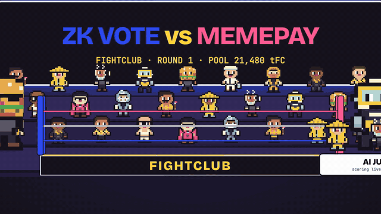
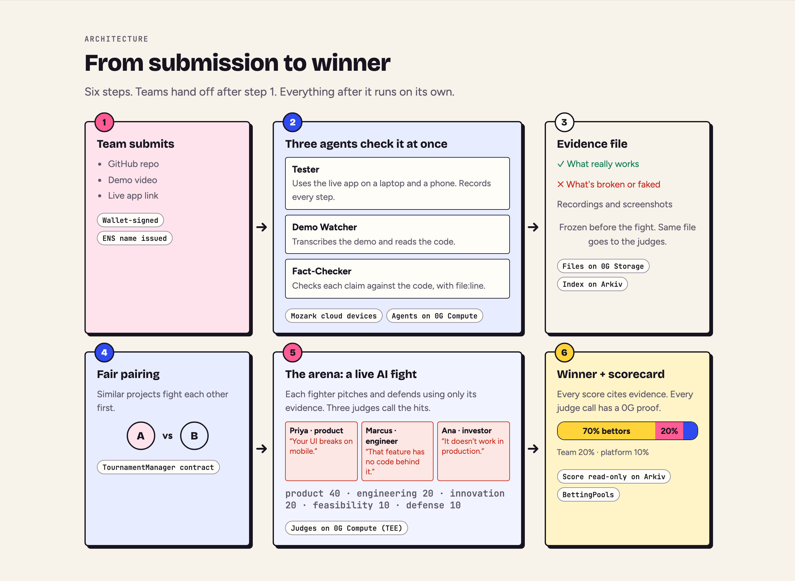
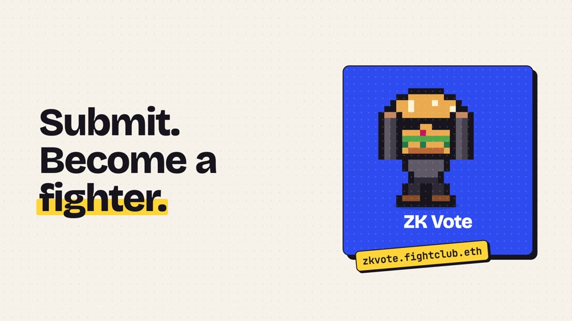
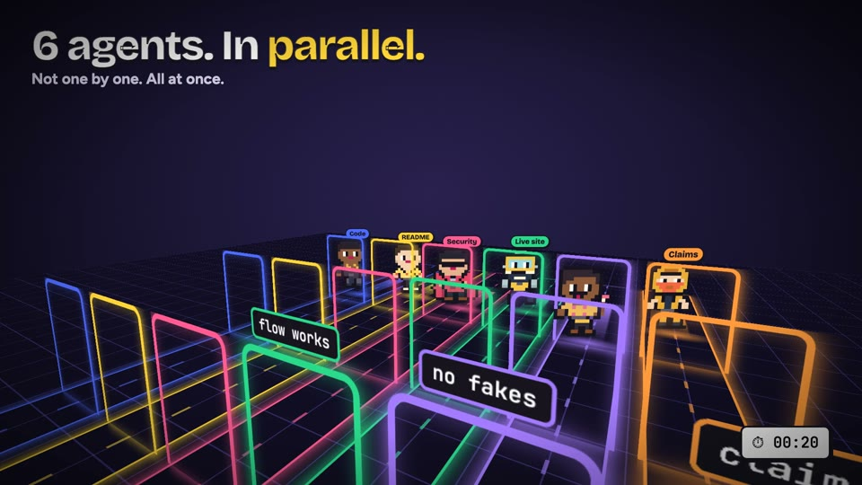
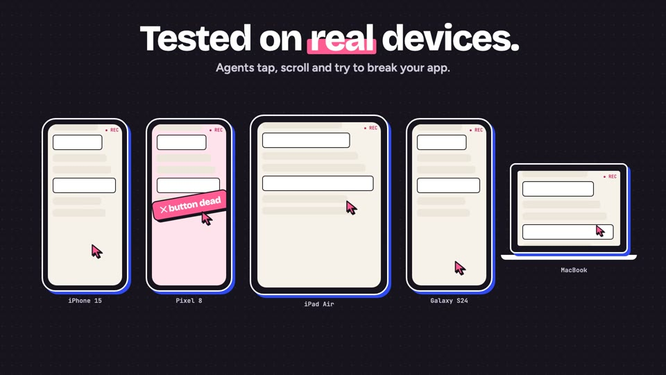
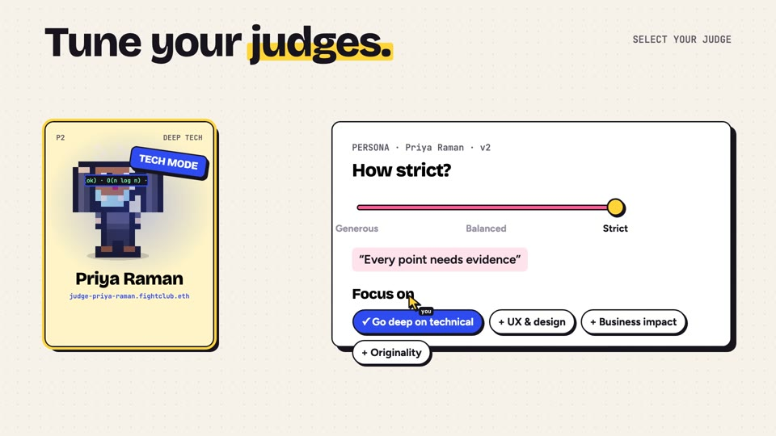
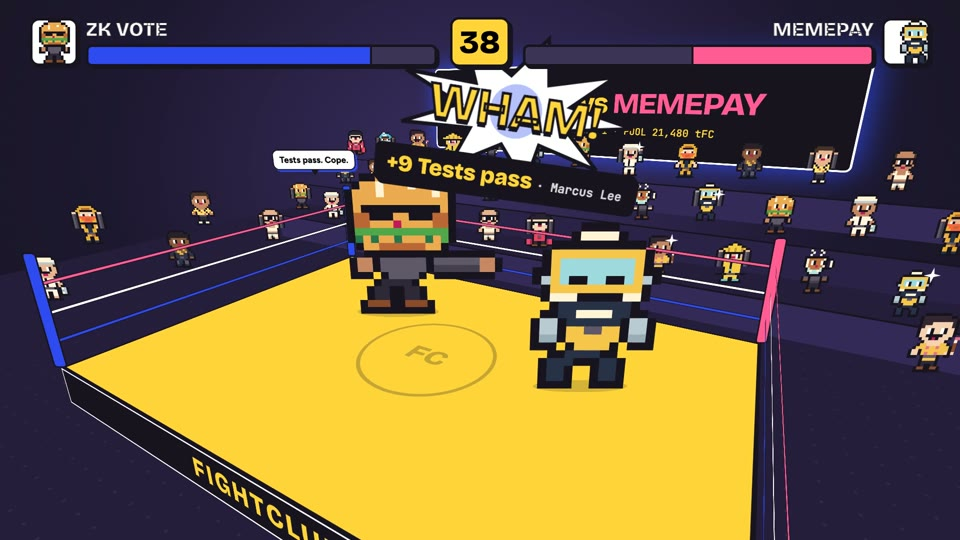
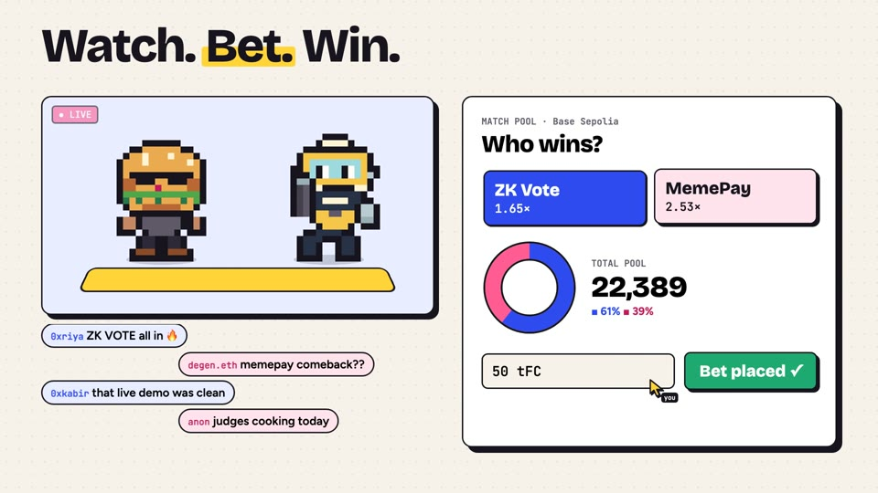
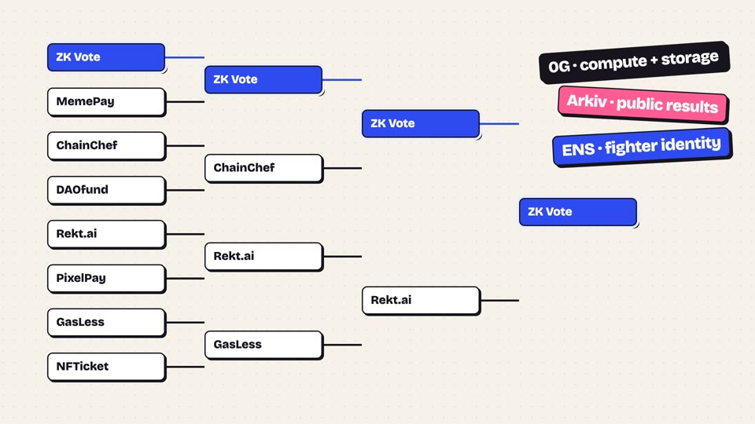
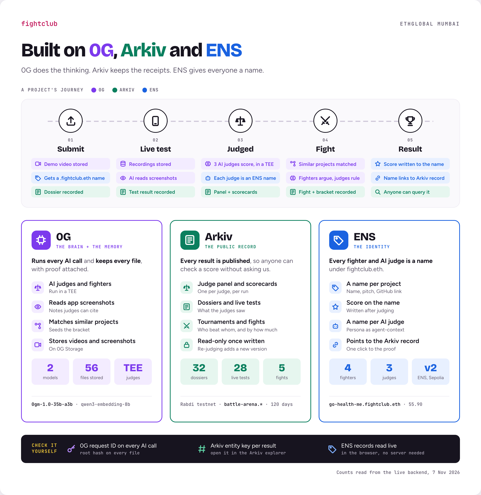

# 🥊 FightClub

**Every hackathon project becomes an AI fighter. AI agents test it, AI judges score it, and the crowd bets on the fight.**

<p align="center">
  <a href="docs/media/fightclub-launch.mp4"></a>
</p>

| | |
| --- | --- |
| 🎬 **Launch video** (60 s) | [docs/media/fightclub-launch.mp4](docs/media/fightclub-launch.mp4) |
| 🎥 **Full demo** (under 3 min) | [Watch on Google Drive](https://drive.google.com/drive/folders/1GGanbgIbKdQawt7-NzCdqjqIbEcO9Zvm?usp=drive_link) |
| 🌐 **Live app** | https://fightclub-seven.vercel.app |
| 📄 **Product spec** | [PRD.md](PRD.md) |

## The problem

A big hackathon gets hundreds of projects, and judges get about 5 minutes for each. Nobody has time to open every repo or try every app, so judges end up scoring the pitch instead of the product.

**FightClub checks every project for real.** AI agents use the live app and read the code, AI judges score the evidence, and every score is public and verifiable.

## How it works



## Core features

| Feature | What it does | Visual |
| --- | --- | --- |
| **Submit once, get a fighter** | Teams send a GitHub repo, demo video and live link. Each project gets a pixel fighter and its own ENS name, `<project>.fightclub.eth`. |  |
| **Agents work in parallel** | Three agents start at the same time. The **Tester** uses the app, the **Demo Watcher** transcribes the demo and reads the code, and the **Fact-Checker** checks every claim against the code, with file and line. |  |
| **Tested on real devices** | The Tester clicks through the live app on a real laptop and phone in the cloud and records every step. Broken flows show up before judging. |  |
| **Tune your AI judges** | Each judge is a persona that organizers set up: background, deal-breakers, strictness (generous to strict) and what to focus on, such as going deep on technical work. |  |
| **AI fighters, live** | Similar projects meet 1v1. Each hit is a judge's point backed by evidence, health bars drop, and the winner gets a scorecard. |  |
| **Bet on the fight** | Every match opens a testnet betting pool with live odds. Winning bettors get 70%, the winning team 20% and the platform 10%. |  |
| **Public, checkable results** | Brackets run on-chain. Every score is published to Arkiv and written to the project's ENS name, and every AI call has a 0G request ID. |  |

## Built on 0G, Arkiv and ENS



### 0G: the brain and the memory

Without 0G, no project can be scored. All three AI judges, the screenshot reader and the voice-note transcriber run on **0G Compute**, and every upload and recording is stored on **0G Storage**.

- Judges use `0gm-1.0-35b-a3b` on a TEE provider. Voice notes use `whisper-large-v3` with `verify_tee=true`.
- The project page shows each judge's request ID, provider and cost as soon as that judge answers.

| Project | Sample 0G request ID |
| --- | --- |
| Go Health Me | `28f56730-dad3-4efb-9b20-0682fba35f96` |
| FitterCoin | `40b30406-96dc-444f-a49b-ddfacddf0749` |
| Mozark App Studio | `9883a36f-cb26-459e-95ef-8f9feeac313a` |

Details: [backend/README.md](backend/README.md#0g-ethglobal-mumbai-build-with-0g-private-computer)

### Arkiv: the public record

After every judged run, the panel and the three judge scorecards are written to Arkiv (Rabdi testnet) as read-only entities. The judges' panel in the app reads them back from Arkiv.

To list every published panel, newest first, paste this into the [Rabdi entity explorer](https://rabdi.explorer.arkiv.network/entity-explorer):

```
arkiv.schema = str('battle-arena.panel') AND $owner = addr(0x429C0C8C8cDBf6b24D02075D808088983988B515) ORDER BY runAt:u64 DESC
```

Docs: [schema](arkiv/schema.md) · [how we use Arkiv](arkiv/how-you-use-arkiv.md) · [why Arkiv](arkiv/why-arkiv.md) · [Swarm upload](arkiv/swarm.md) (built, not deployed)

### ENS: the identity

- **`<project>.fightclub.eth`** is owned by the team's wallet. After each run, the arena writes `arena.score`, `arena.judges`, `arena.ranAt` and `arena.arkiv`, which links to the Arkiv record behind the score.
- **`judge-<name>.fightclub.eth`** publishes each AI judge's persona as ENSIP-26 `agent-context`.
- Fight records (`arena.record`, `arena.titles`) are tallied from matches that the TournamentManager contract finalized.

| Contract (Sepolia) | Address |
| --- | --- |
| UserRegistry | [`0x81bB4AB8FbF29A5e5F1a3c6d56cc37803A09488b`](https://sepolia.etherscan.io/address/0x81bB4AB8FbF29A5e5F1a3c6d56cc37803A09488b) |
| PermissionedResolver | [`0x707D91427a17748bFd4e810613A32a04B506eF25`](https://sepolia.etherscan.io/address/0x707D91427a17748bFd4e810613A32a04B506eF25) |

### Contracts (Base Sepolia, chain ID 84532)

| Contract | Address |
| --- | --- |
| TournamentManager | [`0x45cdb8fc0b250f70f56675e8b6c0c25ac6bd6c03`](https://base-sepolia.blockscout.com/address/0x45cdb8fc0b250f70f56675e8b6c0c25ac6bd6c03) |
| BettingPools | [`0xb73e35494272ec09044893c585b40e0cedb7eb95`](https://base-sepolia.blockscout.com/address/0xb73e35494272ec09044893c585b40e0cedb7eb95) |
| FilterCoin (token) | [`0x564B51f96406328Ad3dBD6E89b63219938F4fbb7`](https://base-sepolia.blockscout.com/address/0x564B51f96406328Ad3dBD6E89b63219938F4fbb7) |

## Run it locally

You need Node.js 22.10+, MetaMask, a 0G Compute Router API key and a Rabdi testnet wallet funded with tGLM ([faucet](https://hub.arkiv.network/faucet)). Use new test wallets only.

```bash
# 1. Backend → http://localhost:3000
cd backend && npm install
cp .env.example .env     # set ZG_API_KEY and ARKIV_PRIVATE_KEY at minimum
npm start

# 2. Web app → http://localhost:5173 (second terminal)
cd frontend/web && npm install && npm run dev
```

Then open **Projects**, pick a sample project, choose **Agent judge** and press **Watch the judges score this on 0G**. A run takes about a minute.

- **Tests:** `cd backend && npm test`, and `cd frontend/web && npm test`
- **Docker:** `docker build -t fightclub . && docker run -p 8080:8080 --env-file backend/.env fightclub`
- **All settings and CLI commands:** [backend/README.md](backend/README.md)

## Repo layout

| Folder | What's in it |
| --- | --- |
| [backend/](backend/README.md) | API server, judges, reviewer agents, 0G, Arkiv and ENS clients, contracts |
| [frontend/web/](frontend/web/README.md) | The web app (PWA) |
| [demo/](demo/README.md) | Self-contained demo build of the app |
| [video/](video/) | Source of the 60 s launch video (Remotion) |
| [arkiv/](arkiv/) · [docs/](docs/) | Prize docs, test guides, images |

## Team

| Name | GitHub | X | Telegram |
| --- | --- | --- | --- |
| Dhruv Bhagatkar | [dhruv2003](https://github.com/dhruv2003) | [@thisissdhruv](https://x.com/thisissdhruv) | [@dhruvdbajajajs](https://t.me/dhruvdbajajajs) |
| Aryan Kyatham | [ARYANK-08](https://github.com/ARYANK-08) | [@kyathamaryan_](https://x.com/kyathamaryan_) | @aryankyatham |
| Shivam Musterya | [musterya-sm](https://github.com/musterya-sm) | [@musteryaSM](https://x.com/musteryaSM) | @shivammusterya |
| Aditi | [uyaditi](https://github.com/uyaditi) | [@uyaditi_](https://x.com/uyaditi_) | [@uyaditi](https://t.me/uyaditi) |
| Aryan Surve | [XeHunter](https://github.com/XeHunter) | [@ARYANSURVE16](https://x.com/ARYANSURVE16) | [@aryansurve](https://t.me/aryansurve) |

## How we used AI

- **In the product:** AI judges (on 0G by default) score projects, and reviewer agents write the evidence file and live-test steps.
- **Building it:** the team used Claude Code to write and review parts of the code, docs and the launch video.

## License

[MIT](LICENSE)
